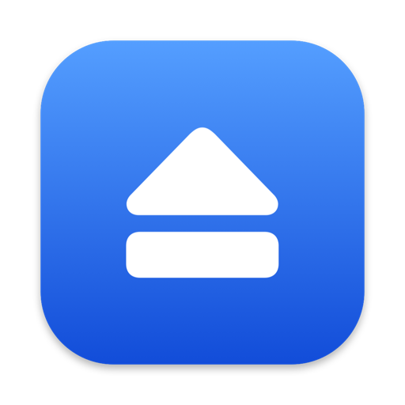

  

<h1 align="center">UMounter</h1>

A lightweight macOS menu bar app for ejecting external disks, disk images and network drives — safely, quickly and automatically.

UMounter lives in your menu bar and ejects everything you have connected with one click or a hotkey. It can also eject for you before sleep, shutdown or logout, and when a disk has been idle for a while. If a disk can't be ejected, it tells you which app is using it and lets you quit that app. It uses about 13 MB of memory and needs macOS 14 Sonoma or later.

## Features

- **One-click eject** of all external disks from the menu bar, or eject a single disk
- **Choose what "Eject All" includes**: hard disks and SSDs, DVDs and CDs, disk images, network drives, SD cards
- **Unmount instead of eject**, so flash drives and SD cards can be remounted without unplugging them
- **Automatic ejection** before system sleep, after the display turns off, and before logout, restart or shutdown
- **Remount after wake** for disks UMounter unmounted for sleep
- **Auto-eject disk images** after a set time, with an option to move installers in Downloads to the Trash
- **Auto-eject idle disks** that nothing has read or written for a while
- **"In use" help**: shows which apps block an eject and lets you quit them
- **Nested disk images** are ejected in the right order
- **Global hotkeys** for Eject All, Eject and Sleep, and Remount
- **Progress HUD** while ejecting, and an optional "safe to unplug" checkmark in the menu bar
- **Notifications and sounds** you can turn on or off
- **Light on resources**: about 13 MB of memory, and less background work in Low Power Mode

## Install

Download the latest `UMounter-<version>.dmg` from [Releases](https://github.com/ja7ad/umounter/releases), open it and drag UMounter to Applications.
